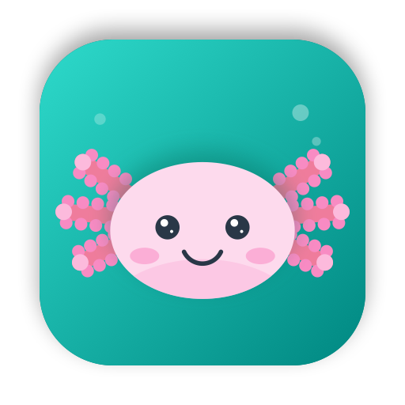

<p align="center"></p>

<h1 align="center">Axolotl</h1>

<p align="center">A beautiful, private, Markdown-first notes app for Mac, iPhone and iPad,<br>with end-to-end encrypted sync between your devices.</p>

<p align="center"><a href="https://nearbycoder.github.io/axolotl/"><b>Download</b></a> · <a href="#sync">Sync</a> · <a href="#building">Build from source</a></p>

---

## Features

**Writing**
- Live Markdown editor that styles as you type: headings, **bold**, *italic*, ~~strikethrough~~, ==highlight==, ~underline~, `code`, quotes, callouts (`> [!NOTE]`), tables, footnotes, inline math, horizontal rules
- Real checkboxes for `- [ ]` todos, bullets for lists, automatic list continuation, Tab / Shift-Tab to indent
- Fenced code blocks with syntax highlighting
- Inline images, file attachments, drag and drop, paste images, photo picker
- iPhone/iPad: formatting bar above the keyboard, Apple Pencil sketches, document scanning
- Typewriter mode, adjustable font, size, line height, paragraph spacing and line width
- Find and replace in a note, version history with restore

**Organizing**
- `#tags`, `#nested/tags` and `#multi word tags#`, with icons, pinning, rename and delete
- `[[Wiki links]]` between notes with autocomplete, backlinks and outgoing links
- Tag and note-link autocomplete while typing
- Pin, archive and trash notes; Notes, Todo, Today, Locked, Untagged, Archive and Trash sections
- Info panel with word count, read time, dates and a table of contents
- Quick Open (⌘O) to jump to any note

**Search**
- Words, `"phrases"`, `-exclusions`, `#tag`, `!#exact-tag`, `-#tag`, `#*/child`, `OR`
- Special filters: `@todo` `@done` `@task` `@today` `@yesterday` `@ctoday` `@last7days` `@created7days` `@date(>2025-01-01)` `@cdate(…)` `@tagged` `@untagged` `@pinned` `@locked` `@images` `@files` `@attachments` `@code` `@wikilinks` `@backlinks` `@untitled` `@empty` `@ocr` `@title` `@conflict`
- Text inside images is recognized on-device and searchable

**Privacy & security**
- Lock individual notes with AES-256-GCM encryption (password + Face ID / Touch ID)
- Lock the whole app with Face ID / Touch ID
- No account, no tracking; notes live on your devices

**Export & import**
- Markdown, plain text, TextBundle, HTML (with embedded images), PDF, RTF, and Word (Mac)
- Export everything as a zip of Markdown files; import Markdown, text, TextBundle and Bear notes
- `axolotl://` URL scheme with Bear-style x-callback-url actions (`create`, `open-note`, `add-text`, `search`, `open-tag`)

**Themes**
Red Graphite, Dark Graphite, High Contrast, Charcoal, Solarized Light/Dark, Dracula, Nord, Tokyo Night, Gruvbox, Catppuccin Latte/Mocha, Everforest, Rosé Pine, Rosé Pine Dawn and Axolotl, with separate light and dark choices.

## Sync

Axolotl ships its own sync engine (in [`Packages/AxolotlKit`](Packages/AxolotlKit)):

- **Local-first.** Every device has a full SQLite replica and works offline.
- **Conflict-free fields.** Each field of each note is stamped with a hybrid logical clock; metadata merges last-writer-wins.
- **Merged text.** Note bodies carry their revision lineage. Concurrent edits are three-way merged word by word, so edits to different parts of a note both survive. When there is no shared history to merge from, the other version is kept as a "conflicted copy", so nothing is lost.
- **End-to-end encrypted.** Everything is derived from a sync code (`AXO-…`): the vault id, the server auth token, and the AES-256-GCM key. Servers and the network only ever see ciphertext.
- **Two transports:**
  - **Nearby devices:** devices with the same sync code find each other over Bonjour and sync directly over the local network, with no server.
  - **Sync server (optional):** a tiny relay you host yourself, for syncing when your devices are apart. It stores only encrypted rows and keeps the latest row per field. It uses long polling, so changes arrive in about a second.

To set it up, open **Settings → Sync → Start Syncing on This Device**, then enter or scan the code on your other devices.

### Running the sync server

```sh
cd server
node server.mjs                 # Node 22.13+; listens on :8787, stores data in ./data
# or
docker compose up -d
```

Put it behind HTTPS (Caddy, Cloudflare Tunnel, Tailscale, Fly.io…) and enter its URL in **Settings → Sync → Sync server**. Set `REGISTRATION=closed` once your vault exists to stop new vaults being created.

## Install

Grab the latest build from the [download page](https://nearbycoder.github.io/axolotl/) or [Releases](https://github.com/nearbycoder/axolotl/releases):

- **macOS 14+:** `Axolotl-macOS.zip` (universal). The build is not notarized, so the first time, right-click the app and choose **Open** (or run `xattr -dr com.apple.quarantine /Applications/Axolotl.app`).
- **iPhone & iPad (iOS 17+):** `Axolotl-iOS.ipa`, an unsigned IPA for sideloading with AltStore, SideStore or Sideloadly. AltStore users can add the source `https://nearbycoder.github.io/axolotl/altstore.json`. Or build it onto your device from source.

## Building

Requirements: Xcode 16+ and [XcodeGen](https://github.com/yonaskolb/XcodeGen) (only needed if you change `project.yml`).

```sh
xcodegen generate              # regenerates Axolotl.xcodeproj
open Axolotl.xcodeproj         # run the Axolotl-macOS or Axolotl-iOS scheme

# tests
swift test --package-path Packages/AxolotlKit
(cd server && npm test)

# release artifacts into dist/
./scripts/build-release.sh
```

## Layout

```
App/Shared        SwiftUI app shared by macOS and iOS (editor, views, model)
App/iOS           iPhone/iPad-only pieces (sketching, scanning, QR)
Packages/AxolotlKit  storage, sync engine, merge, crypto, search, Markdown → HTML
server/           zero-dependency Node sync relay + Dockerfile
docs/             GitHub Pages download site
```

## License

MIT
